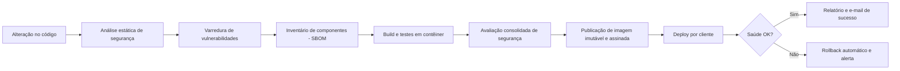

# Abordagem de DevOps e DevSecOps

Visão conceitual de como o HSAgendamentos é entregue em produção. Por segurança, não há detalhes de configuração, nomes de servidores, caminhos, segredos ou scripts.

## 1. Integração contínua com segurança embutida

A cada mudança o pipeline executa, de forma automática:

- **SAST** (análise estática do código-fonte) com Semgrep;
- **Varredura de vulnerabilidades e más configurações** com Trivy, no código e nas imagens de contêiner;
- **SBOM** (inventário de componentes) em formato CycloneDX;
- **Build e testes** em contêineres;
- **Relatório consolidado** de segurança, em português, com resumo por ferramenta e notificação por e-mail.

O próprio pipeline segue as boas práticas de segurança do GitHub Actions e também é analisado pelas ferramentas.

## 2. Cadeia de suprimentos de software

- Imagens **imutáveis**, identificadas pelo commit de origem (nunca por uma tag genérica de "última versão").
- Publicação em registry com **assinatura criptográfica keyless** (Cosign), com verificação de transparência.
- Dependências de ações e imagens fixadas em versões específicas.

## 3. Entrega contínua multi-cliente

- **Ambientes isolados por cliente**, com segredos e variáveis próprios usando os recursos de ambientes do GitHub.
- Escolha do cliente e da versão a implantar no momento da execução.
- Adicionar um novo cliente significa cadastrar um novo ambiente, sem reescrever o processo.
- Comunicação com servidores por chave dedicada, sem senha, de uso exclusivo da automação.

## 4. Deploy com rede de proteção

Cada deploy segue o mesmo roteiro:

1. **Backup preventivo do banco de dados.** Se falhar, o deploy não prossegue.
2. **Registro do estado anterior**, para permitir retorno.
3. Atualização dos serviços com a nova versão.
4. **Verificação de saúde** após a subida.
5. **Rollback automático** se algo falhar na subida, nas migrações ou na verificação.
6. **Relatório de antes e depois** e envio de e-mail de sucesso ou de alerta.

## 5. Gestão de configuração

- Cada ambiente tem sua própria configuração, sem sobrescrever o que já foi definido.
- Quando uma nova versão exige novas variáveis, a automação as **identifica, adiciona de forma não destrutiva e avisa no relatório e no e-mail** que é necessária uma ação manual (por exemplo, credenciais de integração com terceiros).

## 6. Observabilidade e comunicação

- Resumos de execução claros e em português.
- Alertas automáticos para falhas e rollbacks.
- Monitoramento periódico de segurança.

## Tecnologias utilizadas nesta área

GitHub Actions · Docker / Docker Compose · GitHub Container Registry · Semgrep · Trivy · CycloneDX · Cosign (Sigstore) · SSH com chaves dedicadas · Linux

